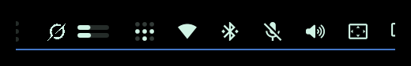
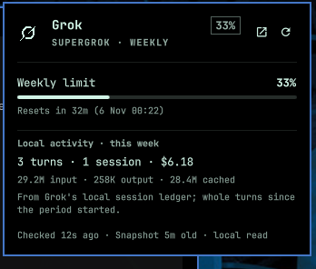

# Grok Usage

[](https://github.com/crueber/omarchy-plugin-grok-usage/actions/workflows/validate.yml)

An Omarchy bar widget for your Grok plan allowance. It draws the official Grok
mark in the bar with the current weekly meter and, when available, Grok Bot's
separate weekly meter; the popup shows percentages, reset clocks, plan tier,
billing amounts, and local Grok session activity for the week and the last 30
days.



There is no API key to paste, no network request, and no second login. The
installed Grok CLI already asks its background service for billing data when a
session starts, and writes the response to a local log:

```
~/.grok/logs/unified.jsonl
  "msg":"billing: fetched credits config"
```

The widget reads that snapshot. It also sums the numeric per-turn ledgers under
`~/.grok/sessions/<workspace>/<session>/usage.json` for local activity.

Grok Bot has a **separate weekly allowance**. Its desktop app caches the
`bot.usage` reading under
`~/.config/Grok Bot/sand-client-persistence/*.blob`; the widget reads the newest
small JSON blob for `percentUsed` and `nextResetMs`. Open Grok Bot to refresh
that cache. The blob is read locally; no token or session cookie is touched.

> `grok usage` (with no session id) is the documented plan endpoint, but only
> on Grok's "daemon route". On the normal local TUI route this build exits 1 and
> says to run `/usage` inside Grok. This widget therefore reads the snapshot
> Grok writes, not the CLI command.



## What it shows

In the bar (default `bars` style):

- the official Grok mark, drawn as a vector from the app icon's two path shapes,
  in the theme foreground
- the current plan meter (weekly on SuperGrok), using the same used-percentage
  Grok's `/usage` modal shows
- a second Grok Bot weekly meter when the Grok Bot app has cached a reading
- warning and urgent colours at `warnPercent` and `criticalPercent`

In the popup:

- **Weekly / monthly / daily limit** with percentage, meter, reset countdown,
  and the absolute local reset clock (the label follows the account's period)
- **Grok Bot weekly limit** with its own percentage, meter, and reset clock
- **Plan tier** from the snapshot (`SuperGrok`, and so on)
- **Billing** rows when the account reports an on-demand cap/usage or a prepaid
  balance
- **Local activity · this week**: sessions, turns, tokens, and the cost Grok
  recorded in its local session ledger
- **Local activity · 30 days**: the same local totals over a rolling month
- a refresh action and a link to grok.com

> Grok's plan allowance is currently a **weekly pool**; the account's billing
> response does not expose a monthly usage limit. The 30-day figure is local
> session usage from Grok's ledgers, not a monthly plan allowance.

The percentage is **used**, not remaining — the same convention as Grok's
limit bar. The label is `Weekly limit` on a weekly plan and follows the
snapshot's `USAGE_PERIOD_TYPE_*` for monthly or daily plans.

## Install

Install it the standard Omarchy way:

```bash
omarchy plugin add https://github.com/crueber/omarchy-plugin-grok-usage --enable
```

Or clone the repo and run the installer:

```bash
git clone https://github.com/crueber/omarchy-plugin-grok-usage.git
cd omarchy-plugin-grok-usage
./scripts/install.sh
```

The installer copies the runtime files to
`~/.config/omarchy/plugins/crueber.grok-usage/`, validates the manifest, and
rescans plugins. It deliberately does **not** add the widget to the bar. Enable
it when you want it:

```bash
omarchy plugin enable crueber.grok-usage --section right
# or, to toggle an already-loaded plugin:
omarchy-shell shell toggle crueber.grok-usage
```

Place it beside another widget:

```bash
omarchy plugin enable crueber.grok-usage --section right --after nino.tailscale
```

## Remove

```bash
omarchy plugin disable crueber.grok-usage
omarchy plugin remove crueber.grok-usage --yes
rm -rf ~/.cache/grok-usage
```

## Use

- **Left click** — open or close the popup
- **Middle click** — re-read the snapshot now
- **Right click** — open grok.com (or `onRightClick` if set)
- **`r`** — re-read while the popup is open

Grok only updates the billing snapshot when a Grok session runs. That is also
the only time your allowance can change, so the widget re-reads the file every
five minutes and shows how old the snapshot is in the popup footer. Run
`grok` once (and open `/usage` if this is the first time) to create the first
snapshot.

## Caching and read pacing

A shell restart creates a fresh QML engine, so the widget keeps its last
successful read on disk:

```
~/.cache/grok-usage/usage.json
```

On startup it paints that result immediately and waits out the rest of the
refresh interval. The file records the last attempt even when the read failed,
so a restart loop or a machine without a Grok log does not spin.

- Automatic read: `refreshIntervalSec`, default **5 minutes** (minimum 60
  seconds).
- Manual read: at most once every **30 seconds**; a click inside that window is
  deferred, not dropped.
- Failed reads back off from **1 minute up to 10 minutes**.
- One bar surface per monitor, but only the elected leader reads; the others
  consume the published result.

These floors are deliberately the same as the sibling OpenCode usage widget.
Reads are local file I/O, but keeping one schedule makes the pair predictable.

## Privacy

- No auth token is read. `~/.grok/auth.json` is never opened.
- No network request is made by the widget or its helper.
- Only billing numbers and numeric token/cost ledgers are read. Prompts,
  responses, session titles, workspace paths, and account identity are not
  parsed or displayed.
- The Grok Bot reading is a small cached JSON blob from the Grok Bot desktop
  app; the helper reads only `percentUsed`, `nextResetMs`, and the plan label.
- The widget's own cache contains only the displayed numbers, the snapshot
  time, and the error string. It lives in a mode-`0700` directory
  (`~/.cache/grok-usage`).

## Development

```bash
./scripts/validate.sh     # manifest + required files
./scripts/test-model.js   # offline fixture: parse payload + round-trip cache
node scripts/collect.js   # inspect the live JSON
node scripts/collect.js --home demo/grok-home   # inspect the demo fixture
```

`demo/` holds an offline Grok home with invented billing and session data,
plus an offline Grok Bot cache fixture, and the capture script that produces
the README images. The test suite uses the same fixtures, so CI never needs a
real Grok install. `AGENTS.md` documents the data sources and invariants. The
live plugin must be updated with `./scripts/install.sh` rather than edited in
place.

## Settings

| Key | Default | Meaning |
| --- | --- | --- |
| `barStyle` | `bars` | `bars`, `text`, or `icon` |
| `showWeekly` | `true` | Show the Grok plan limit meter |
| `showBot` | `true` | Show the Grok Bot weekly meter when cached |
| `refreshIntervalSec` | `300` | Read interval (60–3600) |
| `warnPercent` | `70` | Warning threshold |
| `criticalPercent` | `90` | Critical threshold |
| `warningColor` | `#f67400` | Empty keeps the theme foreground |
| `criticalColor` | `""` | Empty uses the theme urgent colour |
| `nodeCommand` | `""` | Optional path to `node` |
| `grokHome` | `""` | Optional Grok home; default `$GROK_HOME` or `~/.grok` |
| `botHome` | `""` | Optional Grok Bot cache dir; default `~/.config/Grok Bot/sand-client-persistence` |
| `showLocalStats` | `true` | Show local activity in the popup |
| `onRightClick` | `""` | Optional shell command |

For example:

```bash
omarchy bar set crueber.grok-usage refreshIntervalSec 300
omarchy bar set crueber.grok-usage barStyle text
```

## Requirements

- Omarchy with the Omarchy shell bar
- Grok CLI (tested with 1.0.77) with an existing login and at least one session
  so the billing snapshot exists
- Node.js for the small log reader (`node` on the login shell PATH, or set
  `nodeCommand`)

That is all: no API key, no extra packages, no account token, and no network
access.

## Licence

MIT. The Grok mark is traced from the official app icon served at
`https://grok.com/images/favicon.svg`; Grok and xAI are trademarks of their
respective owner.
